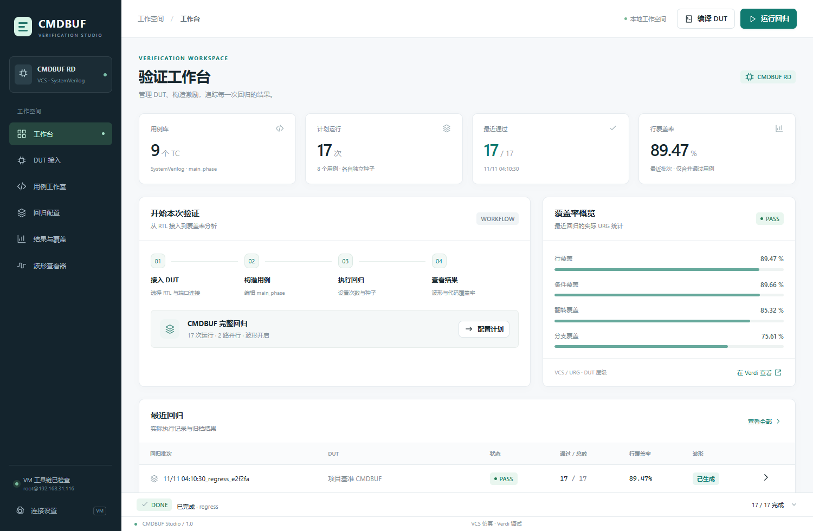

# CMDBUF Studio

用于 CMDBUF RTL 的独立 EDA 验证工作台。提供 DUT 接入、SystemVerilog `main_phase` 用例编辑、严格遵循已登记协议约束的随机回归、内置波形、Verdi 波形与代码覆盖率，以及直接使用 Verdi NPI 的 FSDB 转 Formal。

这是独立源码仓库，使用自己的 Git 历史、设备配置和运行结果目录。编译、运行、打开 Verdi 波形及覆盖率统一通过 Make。支持 Linux 本机 EDA，或 Windows GUI 通过 SSH 调用 Linux 设备。



## 快速启动

在已配置 VCS、Verdi 和许可证的 Linux shell 中，从本仓库或便携包根目录执行：

```bash
make doctor
make smoke
make gui
```

若本站点需要加载环境脚本，先设置 `export EDA_TOOL_SETUP=/absolute/path/to/site_setup.sh`。`doctor` 定位工具和 PLI/NPI 组件，`smoke` 实际编译，执行一个定向用例及两个随机种子并合并覆盖率。

Windows 双击 `CMDBUF Studio.cmd`，或执行：

```powershell
.\make.cmd gui
```

在右上角“设备与 EDA 工具”中选择 SSH，填写 `user@host` 或 SSH 别名、独立远端工作目录，以及可选的环境脚本。先用 `ssh user@host` 验证已有登录。Windows 需要 Python 3.6+ 和 OpenSSH，无需 Windows Make、Node.js 或额外 pip 包。

## 功能入口

| 页面 | 操作 |
|---|---|
| DUT 接入 | 导入当前 CMDBUF 协议接口的其他 RTL，实现文件、模块名称和实例端口连接可编辑 |
| 用例 | 仅显示需要修改的 `main_phase`；在每个 `@(posedge clk)` 后按模板时序赋值，以 `if/else` 实现输入约束 |
| 回归计划 | 逐用例设置回归次数、起始种子、周期数、并行数及是否生成波形 |
| 回归结果 | 查看逐例结论、输入驱动审计和代码覆盖率，一键打开 Verdi 覆盖率 |
| 波形 | 同一 FSDB 可用 Verdi 打开；内置查看器读取其导出的 VCD |
| 波形转 Formal | 导入 FSDB 或选择回归波形，以 NPI 逐拍提取，生成 `pattern` 选择的 `assume` / `assert` |

随机用例在合法 `if` 分支内调用 `$urandom` / `$urandom_range`。driver 检查并复制实际赋值，独立监视器核对端口、四拍 MEM 返回和每个 XAU 的响应顺序；不会隐式修正非法输入。当前约束有版本清单，未知协议不能仅靠工具自动推断。

FSDB 采样保留复位释放后的全部上升沿周期，包括空拍和背压。一份 FSDB 对应一个 `pattern`，多次复位通过 `reset_segment` 分段，`trace_cycle` 保留拍号。输入生成 assume，应比较的输出生成 assert；无效输出负载记录但不强制比较。握手事务另附汇总。生成 SVA 与在 Formal 引擎中执行证明是两个步骤。

## 常用命令

```bash
make compile
make run CASE=tc_directed SEED=17 WAVES=1
make regress SEEDS=1,2,42 CYCLES=2000 JOBS=2 WAVES=1
make wave CASE=tc_random SEED=42
make coverage
make new-case CASE=my_read
make dist
```

Windows 使用相同参数，将 `make` 换为 `.\make.cmd`。`WAVES=0` 时仍保留代码覆盖率，但该轮不会产生可提取的 FSDB。

## 下载与说明

- [便携 ZIP](packages/cmdbuf-studio-portable.zip) / [Linux tar.gz](packages/cmdbuf-studio-portable.tar.gz) / [SHA256](packages/SHA256SUMS.json)
- 用例构造：[main_phase PDF](documents/32_cmdbuf_rd_main_phase_tc_20261111.pdf) / [Word](documents/32_cmdbuf_rd_main_phase_tc_20261111.docx)
- GUI 操作：[Studio PDF](documents/33_cmdbuf_studio_gui_20261111.pdf) / [Word](documents/33_cmdbuf_studio_gui_20261111.docx)
- 波形转 Formal：[NPI 与 SVA PDF](documents/34_cmdbuf_fsdb_formal_20261111.pdf) / [Word](documents/34_cmdbuf_fsdb_formal_20261111.docx)
- 设备迁移：[安装配置 PDF](documents/35_cmdbuf_portable_setup_20261111.pdf) / [Word](documents/35_cmdbuf_portable_setup_20261111.docx)

便携包中运行 `python3 simulation/vcs/portable.py --verify` 可核对逐文件 SHA256。后续修改 TC 或 DUT 后，`make dist` 在 `dist/` 重新制作干净分发包。原有说明编号保留，设备设置与默认路径以第 35 份为准。

## 运行条件与证据

EDA 设备需要 Linux x86_64、Python 3.6+、Bash、GNU Make、与工具版本兼容的 C/C++ 编译器，以及可用的 VCS/Verdi/URG 许可证和 Verdi PLI/NPI 安装。Verdi 窗口需要有效的 DISPLAY 和桌面授权。执行导出包的 `make bmc` / `make cover` 另需 SBY、Yosys、read_slang、ABC 和 Yices；生成 SVA 本身不要求这些 Formal 工具。

本机配置 `eda.local.json`、构建目录、许可证和 EDA 安装文件均不提交。所有 GUI 网页资源本地提供。附带的 CMDBUF RTL 是默认验证对象，其他实现仍须满足所选协议。

- [独立仓库完整性检查](verification/repository_20261111/acceptance.json)
- [Linux 本机与 Windows 加 SSH 的迁移验收](verification/portable_20261111/acceptance.json)：两种 GUI 模式各 3/3 回归，波形和覆盖率打开成功；Linux 单元测试 40/40 通过；生成包 71 步 BMC 与两个终点 cover 通过。
- [FSDB 转 Formal 功能验收](verification/fsdb_formal_20261111/acceptance.json)：3 份波形、5 个复位后区间、205 拍，6,355 个端口值独立核对一致；原生 SVA 重放、有限深度 BMC、终点 cover 和代表注错检查均完成。

保留的验收快照使用其记录中的原始路径和工具版本，文件签名保持不变。有限仿真与轨迹证明不代表所有输入或所有 EDA 版本均已验证；新设备应先运行 `make doctor` 和 `make smoke`。
