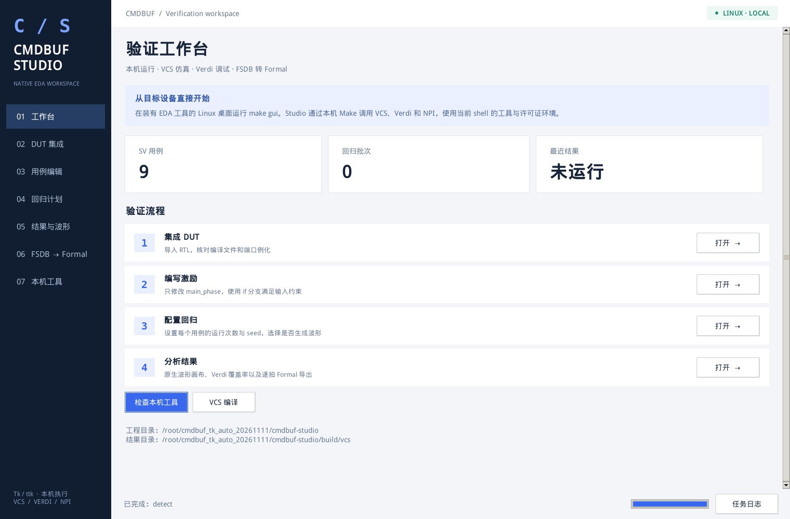

# CMDBUF Studio

原生 **Python Tk / ttk** EDA 验证工作台，直接运行于装有 VCS、Verdi 的 **Linux 目标设备**。包含 DUT 集成、仅编辑 `main_phase` 的 SV 用例窗口、严格按已登记约束随机的回归、内置波形查看、Verdi 波形和代码覆盖率，以及 Verdi NPI 直接解析 FSDB 后生成 Formal 代码。

GUI 不依赖浏览器、HTTP 服务、Node.js 或 SSH。所有 EDA 操作经本机 Make 执行。VM 只用于开发调试，分发包不含 VM 地址或连接流程。本仓库具有独立 Git 历史，与之前的验证仓库分开维护。



## 在 Linux 上启动

在已加载本站点 EDA 工具及许可证环境的图形桌面终端，从工程根目录执行：

```bash
python3 -c "import tkinter; print(tkinter.TkVersion)"
make doctor
make smoke
make gui
```

需要 Python ≥ 3.6、Tk ≥ 8.5、Bash、GNU Make、兼容的 C/C++ 编译器，以及 VCS / Verdi / URG 与 PLI / NPI。GUI 使用 Python 标准库，无需 pip 安装第三方包。若缺少 Tk，Ubuntu/Debian 安装 `python3-tk`，RHEL/CentOS 对应包通常为 `python3-tkinter`。

`make doctor` 检查 Tk、工具与组件；`make smoke` 真实运行 `tc_directed`（seed 1）和 `tc_random`（seed 17、42），并合并覆盖率。启动 GUI 需要有效的 `DISPLAY`。Verdi 继续使用同一图形桌面和授权。

如果需要站点环境脚本：

```bash
export EDA_TOOL_SETUP=/absolute/path/to/site_setup.sh
make gui
```

通常无需填写任何路径：“本机工具”页面自动显示工程位置、启动目录、命令路径与 PLI/NPI；当前 PATH 缺少工具时再尝试当前用户的登录环境。只有特殊站点才使用“高级选项”显式启用手动覆盖。覆盖写入已忽略的 `eda.local.json` 并绑定当前设备；旧 VM 配置、其他设备的覆盖和 `EDA_MODE=ssh` 不会自动套用。

Windows 的 `CMDBUF Studio.cmd` 或 `.\make.cmd gui` 可打开同一原生窗口，编辑工程和查看已有 VCD；EDA 任务请在 Linux 设备运行。

## GUI 功能

| 页面 | 操作 |
|---|---|
| DUT 集成 | 导入 RTL、维护编译配置与 `dut` 例化代码，编辑并保存端口 SVA |
| 用例编辑 | 从模板新建用例；窗口仅显示 `main_phase`，保存时保留构造函数和外层 class |
| 回归计划 | 每用例的启用、运行次数、起始 seed、周期；检查模式、环境 fatal 总开关、断言 fatal 开关、并行数、超时、波形开关 |
| 结果与波形 | 分别显示接口、事务、完整时序结论；失败原拍号、完整快照、日志、波形与覆盖率 |
| FSDB 转 Formal | 原生文件对话框导入 FSDB，或加入回归 FSDB；层级检查、端口映射、pattern 编号和验证包导出 |
| 本机工具 | 自动检测本机环境并显示结果，默认无路径输入；特殊站点覆盖收纳在高级选项 |

用例在每次 `@(posedge clk)` 后按模板的 `#1`、控制驱动、反馈采样顺序赋值。约束写成普通 `if / else`；随机数只能在合法分支内选择。driver 检查并原样驱动，不隐式修正。时钟低/高电平与暂停、复位也由模板中的变量控制。新协议需要显式补充约束清单和检查器。

2026-11-12 接口补充契约适用于复位释放后的每个上升沿采样拍。

| 规则 | 责任与检查 |
|---|---|
| `src=0/1/2` 时对应 `arready[src]=1` | 上游选源约束 `E07_SRC_READY`，也检查 `arvalid=0` 的拍。`src=3` 要求 `arvalid=0`。`arready=000` 时使用 `src=3, arvalid=0`。 |
| `rready[i]=0` 时 `rvalid[i]=0` | DUT 的 R 仲裁从已 ready 的源中选择，`A_R_READY` 检查三位。 |
| `req[b]=0` 时 `ar_rd_gnt[b]=0` | MEM 仲裁输入约束 `E08_AR_GRANT_REQ`。有 `req` 时可以拒绝 grant，同 Bank 的 req 和两个 grant 都为 1 才成功发射。 |

`main_phase` 在 `sample_context()` 后按选中源的 ready 决定是否发送，随机用例从已 ready 的源中选择。按每个 Bank 的 `req` 给 `ar_rd_gnt` 赋值，成功当拍设置对应半区 busy。新约束在 `transaction` 和 `strict` 两种模式均启用。`make constraints` 显示当前契约。历史重放沿用保存的二进制与接口契约版本。

兼容的协议 JSON 内置用例显式设置 `drivers.ar_grant=on_req`，用 `ar_grant_enable` 波形给出每 Bank 的授权许可。固定输入用例按原值驱动并检查约束。

`pending_cnt` 是待发命令数的 4 位寄存输出。复位清零，接收 AR 的上升沿加一，成功发射的上升沿减一，同拍接收和发射相抵。`A_PENDING_RECURRENCE` 在两种模式都用前一采样沿的事件校验寄存递推。`A_COMPARE_PENDING_CNT` 在完整模式比较寄存值与参考模型的拍初待发数。详见 [寄存计数契约](docs/timing/pending_register_20261112.json)。

在 Tk 的“DUT 集成”打开“编辑端口 SVA”并保存，也可以直接编辑 `formal/protocol_20261021/cmdbuf_rd_port_sva.sv`。下一次 `make compile` 或回归使用已保存版本。工具会归档源文件和哈希，结果页可查看该次运行的 SVA 源码。新标签的普通 `assert property` / `assume property` 在两种模式执行。默认失败动作使用工具的 fatal 设置，用户明确写出的动作按其代码执行。`make replay` 使用原仿真二进制和对应的 SVA 归档。

内置查看器是 Tk Canvas，保留四态数值，提供信号筛选、时间缩放、平移、A/B 游标和进制切换。FSDB 显示通过本机 `fsdb2vcd` 转换；**Formal 提取直接使用 NPI 读取 FSDB**。

每份 FSDB 对应一个 `pattern`，复位释放后逐上升沿提取，保留空拍、背压、`reset_segment` 和 `trace_cycle`。输入生成 assume，应比较的输出生成 assert；无效输出负载保留记录但不强制比较。生成 SVA 不等于已完成 Formal 证明，仍需在目标引擎初始化 DUT 并检查断言与终点 cover。

## Make 命令

```bash
make env-info
make compile
make run CASE=tc_directed SEED=17 WAVES=1
make regress SEEDS=1,2,42 CYCLES=2000 JOBS=2 WAVES=1
make regress ENV_FATAL=0 SEEDS=1,2,42 WAVES=1 TIMEOUT=0
make regress CHECK_MODE=transaction ENV_FATAL=1 ASSERT_FATAL=0 SEEDS=1,2,42
make run CASE=tc_directed CHECK_MODE=strict ASSERT_FATAL=1
make check-test JOBS=2
make wave REGRESSION=latest CASE=tc_random SEED=42
make coverage REGRESSION=latest
make coverage-details REGRESSION=latest
make coverage-minimize REGRESSION=latest
make coverage-formal COVERAGE_SET=analysis_id
make wave-file FSDB=/absolute/path/to/input.fsdb
make new-case CASE=my_read TEMPLATE=tc_user_example
make dist
```

`WAVES=0` 保留日志和代码覆盖率，该轮不生成 FSDB / VCD。GUI 运行中可查看实时 Make 日志，任务结束后保留日志与结果。

在「结果与波形」选择历史批次，打开「覆盖率明细」。顶部可直接切换指标，左侧选择实例或模块，右侧在源码行号旁标出已覆盖、部分覆盖、未覆盖和排除状态。点源码行，下方列出对应语句、条件向量、分支结果、每位翻转方向或 FSM 覆盖项。点「上一缺口」「下一缺口」或用 Shift+F8 / F8 跳转。「层级总览」展示 URG 的各项分数，双击指标跳到该范围的源码。源码按构建哈希校验，新构建归档对应 DUT 源码。

点击「最小用例集」可选择一个或多个覆盖定义相同的历史批次。多选以所选批次的合并覆盖率为目标。工具从原来纳入覆盖率的通过用例读取逐例 VDB，以保留每个已命中的代码覆盖项为目标，按用例数求精确最小集。URG 会重新合并所选用例，再核对覆盖项与分数。选集可导出 CSV（批次、用例、seed 与重放命令），也可直接在 Verdi 打开。历史合并库可以单独看明细，筛选需要每个参与合并用例的原始 VDB。

`make coverage-minimize REGRESSIONS=id1,id2 SOLVE_SECONDS=0` 计算多个批次，`0` 表示求解不限时。设定求解时限且未完成证明时，显示已复核候选及最优值上下界。VDB 分块读取并报告进度。终端输出分析编号后，可用 `make coverage-details COVERAGE_SET=编号` 再次打开该分析，或用 `make coverage COVERAGE_SET=编号` 打开对应 VDB。

在选集结果页点「生成选集 Formal」。表中的 `pattern` 从 0 开始，逐个对应原批次、用例与 seed。已有 FSDB 直接使用，缺少 FSDB 的选中用例用原仿真器和归档输入重放，核对原轨迹后读取补出的波形。生成包使用历史构建中可校验的 DUT 源码和接线，包含逐拍输入 `assume`、输出 `assert` 和 pattern 对照。终端可用 `make coverage-formal COVERAGE_SET=编号`。操作见说明 45。

`make wave`、`make wave-file` 及对应 GUI 按钮会自动加入 DUT 顶层全部已记录的信号，包括端口、内部信号和数组，并缩放到完整时间范围。信号列表直接来自 FSDB，更换 RTL 后无需维护固定信号名。外部 FSDB 可指定 `DUT_SCOPE=top.u_cmdbuf`；GUI 使用当前“实例”栏。加载后会核对完整清单，错误实例路径明确报错。操作补充见说明 40。

所有 VCS 编译自动加入 `-lca -licqueue +vcs+lic+wait`；仿真自动加入 `+vcs+lic+wait`，URG 合并自动加入 `+urg+lic+wait`。等待 License 不设超时上限，编译和合并进程也不再使用外层固定超时。`TIMEOUT=120` 只从 VCS 的仿真启动回调之后计算执行时间；`TIMEOUT=0` 表示执行也不限时。GUI 显示等待/启动及执行状态，结果中的 `sim.process.json` 分别记录启动等待和执行耗时。旧归档二进制没有启动回调时，重放保留原二进制并关闭整个进程的超时，以免中断许可证等待。

当前 SV 用例从 t=0 启动时钟，`clk` 初始为 1。`rst_n` 在 t=0 为 0，在 `#1`（1 ns）释放后一直为 1。默认 5 ns 下降、10 ns 上升；`main_phase` 的 `cycle=0` 在 12 ns 驱动，供 20 ns 采样。TC 保持 `rst_n=1`，再次请求拉低会报错。`clock_reset.csv` 记录实际时钟和复位跳变；旧归档重放沿用其原二进制和原时序。说明 38 覆盖旧说明中的多周期复位及用例中再次复位示例。

新计划和无计划的命令行运行默认采用通用事务模式。它保存完整沿前四态快照，按实际握手检查事务、数据和单源顺序；同地址发射保留所有相容的事务对应关系。MEM 输入仍遵守 N+4 契约。参考模型待发数、精确 ready/req/R 调度和最早 N+5 返回显示 `NOT_CHECKED`，不把通用模式通过当作完整时序通过。事务未结束或对应关系候选超过上限时，结果为 `INCOMPLETE`。

`CHECK_MODE=strict` 执行完整时序和当前接口契约的原生 SVA，核对 pending 参考计数和精确调度。旧保存计划没有新字段时继续使用 strict；Make 显式参数优先于计划。`ENV_FATAL=0` 对应 Tk“回归计划”中取消“环境错误立即停止（$fatal）”：main_fail 等可恢复输入约束、赋值/驱动时点错误及断言失败记录后继续运行剩余周期。它是总开关，即使 `ASSERT_FATAL=1`，断言也不会立即中止；重新开启环境开关后恢复原断言选择。默认 `ENV_FATAL=1` 保留原行为，旧计划同样默认开启。

`ENV_FATAL=1 ASSERT_FATAL=0` 只关闭断言中止，环境检查仍立即停止。所有错误仍使结果为 `FAIL`，失败用例波形及单例 VDB 保留、不会合并进通过覆盖率；继续模式不修补 TC 输入，也不改变 SVA 采样或判断表达式。结果页分别显示环境错误、断言错误和“执行完成/中断”，执行完成不等于验证通过。`environment_errors.jsonl` 逐条记录环境错误，`environment_runtime.json` 保存执行完成状态；断言和原始采样继续使用 `assertions.jsonl`、`check_frames.csv` 等。

无效时钟、缺失程序/文件、随机求解无解、驱动状态损坏、watchdog 和工具失败仍终止。TC/DUT 自己的 `$fatal/$stop/$finish` 不由环境开关拦截；例如基准 RTL 对已接收非法 arresp 的 `$stop` 仍会中断并明确判失败。批量运行关闭交互输入，避免 `$stop` 卡在 VCS 提示符等待人工命令。较长用例可另设 `TIMEOUT=0` 取消仿真执行时间上限，License 等待始终不限时。`make replay` 保留原二进制、检查模式及两个 fatal 设置。操作见说明 41，`make env-fatal-test JOBS=2` 可执行正反例验收。

## 下载与说明

- [源码覆盖浏览与选集 Formal PDF](documents/45_cmdbuf_coverage_source_formal_20261113.pdf)
- [代码覆盖率与最小用例集 PDF](documents/44_cmdbuf_coverage_minimum_20261113.pdf)
- [寄存待发计数与 SVA 编辑 PDF](documents/43_cmdbuf_pending_sva_20261112.pdf)
- [接口约束与用例赋值 PDF](documents/42_cmdbuf_interface_constraints_20261112.pdf)
- [环境 fatal 总开关与继续运行 PDF](documents/41_cmdbuf_environment_fatal_20261112.pdf)
- [Verdi 自动加载 DUT 顶层信号 PDF](documents/40_cmdbuf_verdi_dut_signals_20261111.pdf)
- [License 等待与执行超时 PDF](documents/39_cmdbuf_license_wait_20261111.pdf) / [Word](documents/39_cmdbuf_license_wait_20261111.docx)
- [时钟与复位启动时序 PDF](documents/38_cmdbuf_startup_20261111.pdf) / [Word](documents/38_cmdbuf_startup_20261111.docx)
- [检查模式与 fatal 操作说明 PDF](documents/37_cmdbuf_check_modes_20261111.pdf) / [Word](documents/37_cmdbuf_check_modes_20261111.docx)
- [便携 ZIP](packages/cmdbuf-studio-portable.zip) / [Linux tar.gz](packages/cmdbuf-studio-portable.tar.gz) / [SHA256](packages/SHA256SUMS.json)
- **当前 Tk 本机版操作手册**：[PDF](documents/36_cmdbuf_native_tk_20261111.pdf) / [Word](documents/36_cmdbuf_native_tk_20261111.docx)
- main_phase 详细写法：[PDF](documents/32_cmdbuf_rd_main_phase_tc_20261111.pdf) / [Word](documents/32_cmdbuf_rd_main_phase_tc_20261111.docx)
- NPI 与 Formal 语义：[PDF](documents/34_cmdbuf_fsdb_formal_20261111.pdf) / [Word](documents/34_cmdbuf_fsdb_formal_20261111.docx)

说明 33 和 35 保留为历史版本，其浏览器界面、SSH 操作流程已由 36 替代。便携包可运行 `python3 simulation/vcs/portable.py --verify` 核对文件，修改工程后通过 `make dist` 重新打包。机器配置、许可证、EDA 二进制、编译缓存和既有结果均不分发。

## 验证记录

[源码覆盖浏览与选集 Formal 验收](verification/coverage_source_formal_20261113/acceptance.json)记录实例和模块分数、源码行联动、缺口导航、带波形与补波形的选集导出，以及生成 SVA 的原生编译。

[代码覆盖率与最小用例集验收](verification/coverage_minimum_20261113/acceptance.json)记录真实历史 VDB 读取、Tk 源码定位、跨批次精确求解、URG 复核和 Verdi 打开选集，以及一万候选的独立求解测试。

[寄存计数与 SVA 编辑验收](verification/pending_sva_20261112/acceptance.json)包含待发计数的实际波形变化、提前组合与多延迟一拍的反例、Tk 保存自定义属性后的 VCS 结果，以及按原 SVA 版本重放的记录。

[20261112 接口约束验收](verification/interface_constraints_20261112/acceptance.json)记录了 27 个 `main_phase` 正反例、76 个兼容协议与约束场景、82 项断言检查、16 次默认回归及新旧归档重放。接口规则的正反例覆盖满载空闲、空闲源选择、无请求授权及 R 通道背压。

[环境 fatal 验收](verification/environment_fatal_20261112/acceptance.json)记录了 21 个真实 VCS 场景的 118 项检查、原断言 76 项验收、main_phase 的 11 个正例和 13 个预期反例，以及 Tk 保存/恢复开关、两种子错误继续运行、覆盖率隔离、内置波形和归档重放。故意报错后跑完的用例仍判 FAIL。

[License 等待验收](verification/license_wait_20261111/release.json)包含真实 VCS / URG 命令参数、启动后计时、零执行超时、新旧归档重放、并行等待取消，以及中文带空格目录中的便携包和 Tk 回归操作。延迟启动测试验证等待超过执行期限仍能通过；没有人为耗尽或修改许可证服务器。

[原生 Tk 本机版验收](verification/tk_studio_20261111/acceptance.json)记录了 Linux 上未配置环境脚本路径、未设置 VCS_HOME/VERDI_HOME 时的自动检测，以及真实窗口和本机 Make 流程：导入 DUT、只修改 main_phase、6 次带波形回归、逐例 seed 计数、内置波形、Verdi 波形和覆盖率、导入 FSDB、NPI 层级检查、双 pattern 导出，以及关闭波形后的单次回归。

新的 GUI 验证不修改之前封存的 [FSDB 与 Formal 验收](verification/fsdb_formal_20261111/acceptance.json)、[原迁移验收](verification/portable_20261111/acceptance.json) 和 [仓库完整性检查](verification/repository_20261111/acceptance.json)。旧记录对应其当时的代码和工具版本。新设备仍应执行 `make doctor` 和 `make smoke`；有限仿真与轨迹证明不代表任意输入或任意 EDA 版本均已验证。
